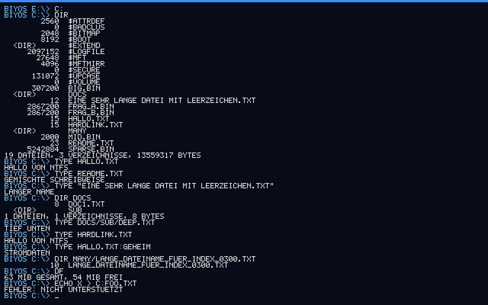

# BIYOS — Build It Yourself Operating System

[English version](README.md) · MIT-Lizenz · **Alpha / Hobbyprojekt**

BIYOS ist ein kleines x86_64-Betriebssystem, komplett von Grund auf geschrieben: eigener UEFI-Bootloader,
eigener Kernel, eigene Treiber, Dateisysteme und Shell — ohne Bibliotheken und ohne fremden Kernel. Ich **vibe code** es mit Claude Sonnet 5.5. 
Die Grundidee:

> **Programme bekommen so viel Kontrolle über die Maschine wie möglich.** Alles läuft in Ring 0 in einem
> flachen Adressraum, jede Seite ist lesbar, schreibbar und ausführbar. Es gibt keinen Speicherschutz,
> keine Systemaufruf-Grenze, und jeder Kernel-Dienst ist ein Funktionszeiger, den jedes Programm ersetzen darf.

Es ist ein System zum Lernen und Experimentieren, **nicht** sicher und nicht für den Alltag gedacht.



## Stand

Funktioniert (in QEMU + OVMF getestet, **nicht** auf echter Hardware): UEFI-Bootloader mit Menü, GDT/IDT/Paging,
Exception-Ausgabe, Speicherverwaltung, Funktionstabelle `kapi`, ACPI/IOAPIC, APIC-Timer, präemptiver Scheduler,
PS/2-Tastatur (DE/US), scrollende Konsole, PCI, NVMe, GPT/MBR, **FAT32 (lesen/schreiben, lange Namen)**,
**NTFS (lesen, dazu experimentelles Schreiben: Anlegen/Ändern/Anhängen/Löschen/Umbenennen, Verzeichnisse, Hardlinks, benannte Streams)**, VFS mit
Laufwerksbuchstaben, **Executable-Loader (`run`/`start`) mit `DRIV`/`STRT`/`PLSE`**, Kernel-Module (`module load/remove`), `IMPORT`-Section,
`C:\Start` für `STRT`-Programme, eine **austauschbare Shell**, ein **Text-/Hex-Editor (`edit`)**, `kapi` bis Version 9 für Treiber (PCI, IRQ,
Blockgeräte, Tastatur) und eine **USB-Tastatur samt USB-2-Hubs** (xHCI + HID, Modul `usbhid.drv`) und **SATA-Platten** (AHCI, Modul `ahci.drv`), beides bisher nur in QEMU getestet sowie eine Notfall-Shell
(`peek`/`poke`, `hexwrite`, Dateibefehle).

**Deutsch und Englisch** als Oberfläche (`lang=de|en` und `layout=de|us` in der `boot.cfg`, zur Laufzeit `LANG EN`/`LAYOUT US`, mit `SAVE` dauerhaft). **Installer** (Befehl `install` oder automatisch von der bootbaren **ISO**, `tools/make-iso.sh`): legt eine GPT mit EFI-Partition (FAT32) und einer **zweiten Partition mit NTFS** an und kopiert BIYOS darauf; `mkfs ntfs|fat32` formatiert einzelne Partitionen. Bisher nur in QEMU getestet. Geplant: USB-Mäuse/-Speicher, ACPI-Ausschalten.

## Sicherheit — bitte lesen

* BIYOS hat bewusst keinen Schutz. Ein fehlerhaftes Programm kann den Kernel oder jeden erreichbaren Datenträger überschreiben.
* **In einer virtuellen Maschine** oder auf einem Ersatzrechner ausprobieren, nie mit Datenträgern, die dir wichtig sind.
* Alle Laufwerke werden automatisch **nur lesend** eingebunden. Schreiben muss man pro Laufwerk freigeben
  (`mount nvme0p1 e rw`). **NTFS-Schreiben ist experimentell:** BIYOS verweigert es, solange das Volume nicht sauber ist
  (Dirty-Flag, unsauberes Journal, Windows-Ruhezustand/Schnellstart). Es wurde nur mit `ntfs-3g`/`ntfsresize` in QEMU
  geprüft, **nie mit Windows/chkdsk**. Nicht auf einer Windows-Systempartition verwenden.
* Die Treiber schreiben nie von selbst. Der einzige Schreibtest ist eine Compile-Option für Wegwerf-Abbilder.
* BitLocker-Laufwerke werden erkannt, aber nicht gelesen. Bei Windows-Schnellstart kann ein NTFS-Laufwerk veraltete
  Daten zeigen (das Journal wird nicht ausgewertet). Der Bootloader ist nicht signiert: Secure Boot muss aus sein.

## Schnellstart (Ubuntu / WSL)

```sh
sudo apt install build-essential gcc-mingw-w64-x86-64 make qemu-system-x86 ovmf gdisk dosfstools mtools python3
make -C boot esp
make -C kernel && make -C kernel esp
sh tools/make-test-image.sh nvme.img
make -C boot run NVME_IMG=../nvme.img
```

Ein Testabbild mit echtem, gefülltem NTFS gibt es mit `sh tools/make-ntfs-test-image.sh` (braucht `ntfs-3g` mit FUSE).
Beim Start: innerhalb von 3 Sekunden eine Taste drücken für das Bootmenü. Danach landest du in der Shell (`help`).
Tests laufen über `tools/qemu_shell_test.py` (tippt Befehle per QEMU-Monitor und zeigt das serielle Protokoll).

Mehr Details (Architektur, Befehlsliste, Header-Format, Testen, Roadmap) stehen in der [englischen README](README.md).

## Mitmachen und Lizenz

Siehe [CONTRIBUTING.md](CONTRIBUTING.md). Lizenz: [MIT](LICENSE).
