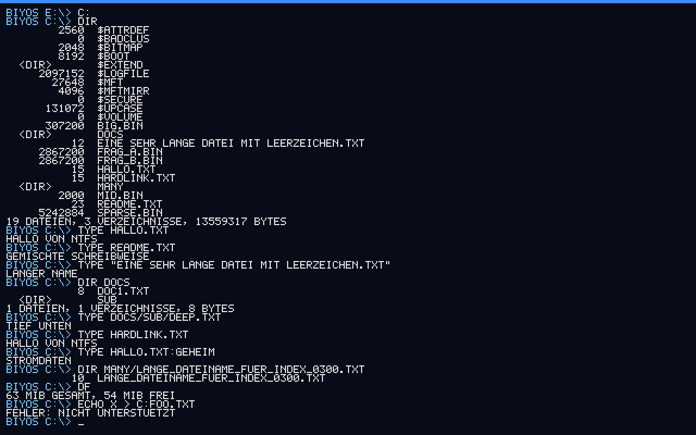

# BIYOS — Build It Yourself Operating System

[Deutsche Version](README.de.md) · MIT licensed · **alpha / hobby project**

BIYOS is a small x86_64 operating system written from scratch: its own UEFI bootloader, its own
kernel, its own drivers, filesystems and shell — no libraries, no borrowed kernel.I am vibe coding it with Claude Sonnet 5.5. It is built around
one unusual idea:

> **Programs get as much control over the machine as possible.** Everything runs in ring 0 in a single
> flat address space. Every page is readable, writable and executable. There is no memory protection,
> no system-call boundary, and every kernel service is a function pointer that any program may replace.

It is an educational and experimental system — a playground for people who want to see (and change)
what is underneath. It is **not** a secure or production operating system, and it is not meant to be.



## Status

| Area | State |
|---|---|
| UEFI bootloader (x86_64, PE32+), boot menu, ELF64 kernel loading, module loading | working |
| GDT/TSS, IDT, exception dump (register state, page-fault address), identity-mapped paging (WB/WC/UC per region, no NX) | working |
| Physical page allocator, kernel heap, `paging_map` / `paging_unmap` | working |
| Kernel function table `kapi` (console, memory, paging, tasks, input, files) — replaceable at runtime | working |
| ACPI MADT parsing, IOAPIC routing, Local-APIC timer (PIT-calibrated, 100 Hz) | working |
| Preemptive round-robin scheduler (tasks, `sleep`, `yield`) | working |
| PS/2 keyboard (German and US layout), scrolling framebuffer console, COM1 mirror | working |
| PCI scan, **NVMe driver**, block layer, GPT/MBR partitions, filesystem detection | working |
| **FAT32**: read/write, long file names, directories, move/rename | working |
| **NTFS**: read, plus **experimental write** (create/modify/append/delete/rename, mkdir, hard links, named streams, 900-file directories) | working, experimental |
| Virtual file system with drive letters (`C:` = first NTFS volume, `E:`… = FAT32), per-drive working directory | working |
| Emergency shell with `peek`/`poke`, `hexwrite`, file commands | working |
| Executable format (`DRIV` / `STRT` / `PLSE`), loader (`run`, `start`), kernel modules (`module load/remove`, also from `boot.cfg`), `IMPORT` section | working |
| `C:\Start` (all `STRT` executables in it start at boot), `kapi` v6 for drivers (PCI, IRQ routing, block devices, key injection) | working |
| Replaceable shell (a `STRT` program in `C:\Start` takes over, `kapi` v7) | working |
| `edit` (nano-like text editor and `-hex` editor), `kapi` v8 (drive/mount/copy/statfs functions, cell console, arrow keys) | working |
| USB keyboard (xHCI + HID boot protocol, hot-plug, key repeat) and USB-2 hubs (also nested) as the driver module `usbhid.drv` | working (QEMU only) |
| SATA disks (AHCI, LBA48/LBA28, polled DMA) as the driver module `ahci.drv` | working (QEMU only) |
| Installer (`install`, bootable ISO): GPT with a FAT32 EFI partition and a NTFS data partition, BIYOS copied onto it; `mkfs ntfs|fat32` | working (QEMU only) |
| English and German user interface (`lang=de|en`, `layout=de|us` in `boot.cfg`; `LANG`/`LAYOUT <x> SAVE` in the shell) | working |
| USB mice/storage, ATAPI/NCQ/hot-plug for SATA, ACPI power-off, SMP, networking | planned |

Everything above was developed and tested in **QEMU + OVMF**. It has **not** been tested on real hardware.

## Safety — please read

* BIYOS deliberately has no protection. A buggy program can overwrite the kernel or any disk it can reach.
* **Run it in a virtual machine** or on a spare machine. Do not point it at a disk with data you care about.
* To limit accidents, **all volumes are mounted read-only** automatically. Writing must be enabled
  explicitly per drive (`mount nvme0p1 e rw`).
* **NTFS writing is experimental.** BIYOS refuses it unless the volume is clean (no dirty flag, clean journal, no
  Windows hibernation/Fast Startup file). It does not write the NTFS journal: like ntfs-3g it resets `$LogFile` on the first
  write and keeps the dirty flag set while an operation runs. It was verified with `ntfs-3g`/`ntfsresize` in QEMU,
  **never with Windows/chkdsk**. Do not use it on a Windows system volume; use a throw-away NTFS image or data partition.
* The drivers never write on their own. The only disk-write self-test is a compile-time option
  (`BIYOS_DISK_WRITE_TEST`) meant for throw-away test images.
* Windows volumes: BitLocker volumes are detected but not readable. A Windows "Fast Startup"
  (hibernated) NTFS volume can show stale data because the NTFS journal is not replayed.
* The bootloader is unsigned — Secure Boot must be off to try it on real firmware.
* MIT license: provided "as is", without warranty of any kind.

## Quick start (Ubuntu / WSL)

```sh
sudo apt install build-essential gcc-mingw-w64-x86-64 make qemu-system-x86 ovmf \
                 gdisk dosfstools mtools python3

make -C boot esp                       # UEFI bootloader (MinGW cross compiler → BOOTX64.EFI) + ESP folder
make -C kernel && make -C kernel esp   # kernel (ELF64) → boot/esp/BIYOS/kernel.elf
make -C modules esp                     # driver modules (usbhid.drv, ahci.drv) → boot/esp/BIYOS/modules/ (needs gcc, ld, objcopy, python3)
sh tools/make-test-image.sh nvme.img     # 128 MiB GPT disk image: FAT32 partition + placeholder NTFS partition (NOT mountable:
                                         # the boot log shows "NTFS: UNGUELTIGE PARAMETER"; use make-ntfs-test-image.sh for a real one)
make -C boot run NVME_IMG=../nvme.img  # boot in QEMU with OVMF and an emulated NVMe drive
```

If OVMF lives elsewhere, pass `OVMF=/path/to/OVMF.fd`. For a populated *real* NTFS test volume
(directories, hard links, streams, a 600-file index, sparse file) use `sh tools/make-ntfs-test-image.sh`
(needs `ntfs-3g` with FUSE).

On boot, press any key within 3 seconds for the boot menu (normal / without modules / choose modules).
You land in the shell. Try:

```
BIYOS E:\> mount                       # C: = NTFS, E: = FAT32, both read-only
BIYOS E:\> c:
BIYOS C:\> dir
BIYOS C:\> type hallo.txt:geheim       # NTFS named stream
BIYOS C:\> mount nvme0p1 e rw          # allow writing to the FAT32 volume
BIYOS C:\> hexwrite 00 01 02 "Hello" > e:test.bin
BIYOS C:\> copy c:big.bin e:           # copy between filesystems
BIYOS C:\> peek 100000 20              # raw memory dump
```

### Booting on real hardware (at your own risk)

Create a FAT32 EFI System Partition on a **USB stick** and copy: `BOOTX64.EFI` → `EFI/BOOT/`,
`kernel.elf` and `boot.cfg` → `BIYOS/`. Disable Secure Boot, boot the stick. Use a machine you can afford to
break. The PS/2 keyboard driver works with internal laptop keyboards. USB keyboards need the `usbhid.drv` module (copy it to
`BIYOS/modules/`, it is listed in `boot.cfg`); it has only been tested in QEMU so far, so treat it as experimental on real
hardware (LS/FS devices behind real high-speed hubs use the Transaction Translator path, which QEMU cannot exercise).

## Shell commands

| Command | Description |
|---|---|
| `help` | list commands |
| `dir`/`ls`, `cd`, `pwd`, `type`/`cat`, `mkdir`, `del`/`rm`, `copy`/`cp`, `ren`/`mv`, `df` | files and directories (`/` or `\`, optional drive, case-insensitive) |
| `E:` | change drive |
| `mount [<dev> <letter> [rw]]`, `umount <letter>` | drives; automounted read-only |
| `echo text > file`, `>>` | write / append text (quote names with spaces) |
| `hexwrite 00 01 "Hello" > file` | write raw bytes and ASCII; hex tokens may be `0A`, `0xFF`, `DEADBEEF` |
| `peek <addr> [len]`, `poke <addr> <value> [1\|2\|4\|8]` | read / write any memory (hex) |
| `pci`, `disks`, `diskread <dev> <lba>` | hardware and block devices |
| `run <file> [args]`, `start <file> [args]` | run a `PLSE`/`STRT` program and wait / as its own task; typing the name of an executable file does `run` |
| `module list`, `module load <file.drv>`, `module remove <name\|nr>` | kernel modules (`DRIV`); modules from `boot.cfg` start after the drives are mounted |
| `mem`, `uptime`, `tasks`, `ver`, `layout de\|us` | system info |
| `reboot`, `shutdown` | restart; power-off currently works in VMs only |

## How it works

**Boot.** `boot/` is a UEFI application built with MinGW. It reads `\BIYOS\boot.cfg`, shows a menu on a key
press, loads the ELF64 kernel to its link address (1 MiB), loads modules, collects the GOP framebuffer,
the ACPI RSDP and the memory map, calls `ExitBootServices` and jumps to the kernel with a `BootInfo`
pointer (System V ABI).

**Kernel.** `kernel/` is freestanding C. After switching to its own stack it sets up GDT/TSS, IDT, and flat
identity-mapped page tables, then the memory manager, timer/scheduler, keyboard, storage and the shell.
Exceptions print the full register state and halt instead of silently rebooting.

**The function table.** All replaceable services live in the `KernelApi` struct (`kernel/kapi.h`). The
kernel itself calls them through that table, so a program can substitute, wrap or extend a service:

```c
void *(*orig)(size_t) = kapi.malloc;
kapi.malloc = my_counting_malloc;      // every allocation now goes through your code
```

Because everything is ring 0 and writable, programs can also patch kernel code directly, build their own
page tables and load `cr3`, or take over the timer. That is the point.

**Storage stack.** `PCI → NVMe → BlockDev (disk + partitions, GPT/MBR) → Fs (FAT32 / NTFS) → VFS`.
The VFS maps drive letters, keeps a working directory per drive and refuses writes on read-only mounts.
Filesystem and block-device operations are function pointers too.

### Executable format

BIYOS executables start with a fixed 20-byte header (all numbers big-endian, so they stay readable in a hex dump):

| Offset | Size | Content |
|---|---|---|
| 0 | 1 | `0xAA` |
| 1 | 3 | ASCII `EXE` |
| 4 | 4 | type: `DRIV` (driver/kernel module), `STRT` (run at boot), `PLSE` ("please execute", normal program) |
| 8 | 4 | version |
| 12 | 8 | skipped |

An optional **`IMPORT` section** may follow directly (`"IMPORT"`, then a 4-byte length of the entries). Each entry is
`X` (4), `Y` (4), `TARGET` (4), `NL` (1), `NAME` (`NL` bytes): *"bytes X…Y-1 of file NAME are a function; copy them to
offset TARGET of this program"*. The program reserves that space itself (NOPs, zeros) and calls it with a normal
`call rel32`, so there is no GOT/PLT. The loader copies the bytes in before the program starts. A name without a path
is looked up next to the executable first, then in the current directory. Imported bytes must be position-independent
and follow the System V ABI.

The code starts right after the header (and the `IMPORT` section) and is the entry point. The whole file is loaded to a
16-byte aligned heap address and executed in place, so code must be position-independent.

```
int entry(KernelApi *api, int argc, char **argv);     // System V ABI; return 0 = ok (a bare `ret` works)
```

* `PLSE`/`STRT`: `argv[0]` is the path as typed. `run` executes in the calling task and frees the program afterwards;
  `start` creates a task and frees the program when it returns. A program that calls `kapi.task_exit()` instead stays
  resident.
* `DRIV`: called with `argc = 0` when loaded and `argc = -1` when removed (return non-zero to refuse removal). A module
  can add shell commands with `kapi.cmd_register`; they disappear when the module is removed. Anything else it installs
  (interrupt handlers, tasks, replaced `kapi` entries) it must undo itself.
* `tools/make-module.py` builds executables (including `IMPORT` sections) for tests; `tools/exec-tests/` has small
  assembly examples (`hello`, `args`, `call` with an import, `bg`, and drivers `hi`, `fail`, `busy`).

### Start folder and drivers

* **`C:\Start`**: after the drives and boot modules are up, every file in `C:\Start` whose header says `STRT` is started as
  its own task, in alphabetical order (other files are ignored). The built-in emergency shell always starts as well.
* **Hardware access for `DRIV` modules** (`kapi` v6, see `kernel/kapi.h`): `pci_count/pci_get/pci_find_class`,
  `pci_read32/pci_write32`, `pci_enable`, `pci_bar` (then `map`); `irq_route` / `irq_route_gsi` + `set_handler`
  (the handler must call `irq_eoi()`); `blk_register` + `blk_scan` + `automount` (new disks show up like NVMe
  ones, already mounted drives stay untouched); `kbd_inject` (e.g. for a USB HID driver). There is no automatic
  matching of devices to drivers: a module looks for its device in its entry point. Check `api->version` before using
  newer fields, new entries are always appended.
* Drivers can be written in C: include `kapi.h`, put the entry point in section `.text.entry`, compile with `-fPIE
  -ffreestanding -mgeneral-regs-only` and link with `tools/exec-tests/flat.ld` (`hwtest.c` and `build.sh` show the
  exact flags). Do not use static function-pointer tables, they need relocations; assign them at run time.

### Replacing the shell

The built-in shell is only the emergency/default shell. A `STRT` program in `C:\Start` can replace it:

* `kapi.shell_stop()` ends the built-in shell, or stops it from starting if it has not started yet (`STRT` programs run
  before it, and the kernel waits 200 ms after starting them). From then on the program owns the keyboard and console.
* `kapi.shell_start()` brings the built-in shell back (the replacement's `exit` should call it).
* A replacement shell needs more than `putc`/`getkey`, so `kapi` v7 adds `file_stat`, `file_list`, `cur_drive`,
  `cur_path`, `set_drive`, `chdir` (the working directory is shared with `exec_run` and the file functions),
  `strerror`, `con_clear` and `con_backspace`. Programs are launched with `exec_run` / `exec_start`.
* It also works when the replacement is started from the built-in shell with `run` (it then runs inside the shell's own
  task and the built-in shell ends after it returns) or with `start`.
* **Rescue:** if a broken replacement locks you out, choose `[2] Ohne Module booten` in the boot menu. That also skips
  `C:\Start`, so the built-in shell comes up.
* `tools/exec-tests/mshell.c` is a small replacement shell in C (`dir`, `cd`, `type`, `echo`, `X:`, program launching,
  `exit`). Copy the built `mshell.strt` to `C:\Start` to try it.

### Editor and `kapi` v8

* **`edit <file>`** is a nano-like text editor, **`edit -hex <file>`** a hex editor. `^S` saves, `^X` quits (asks if there
  are unsaved changes). Text mode: arrows, Home/End (also `^A`/`^E`), PgUp/PgDn, Del, Backspace, Tab (4 columns);
  CRLF files keep their CRLF on save; non-ASCII bytes are shown as `?` and left untouched. Hex mode: type hex digits
  to overwrite (typing at the end appends), Ins inserts a `00` byte, Del removes a byte. Files up to 8 MiB.
  New files are created on the first save. Drives are read-only by default, so run `mount <device> <letter> rw` first.
  The editor needs the framebuffer console (it draws with `con_put_at`) and restores the previous screen on exit.
* **Keys:** arrow keys and friends arrive as `KEY_UP`, `KEY_DOWN`, `KEY_LEFT`, `KEY_RIGHT`, `KEY_HOME`, `KEY_END`,
  `KEY_PGUP`, `KEY_PGDN`, `KEY_DEL`, `KEY_INS` (0x80-0x89, see `kapi.h`); `^A`..`^Z` arrive as 1..26.
* **File functions** (all go through the VFS, so FAT32 and NTFS behave the same): `file_read_all`, `file_read`,
  `file_write`, `file_mkdir`, `file_remove`, `file_rename`, `file_stat`, `file_list`, `chdir`/`cur_path`/`cur_drive`/
  `set_drive` (v4-v7), plus in v8 `file_copy`, `file_statfs`, `drive_info`, `file_mount`, `file_unmount` and
  `file_set_rw` (switch a drive between read-only and read/write).
* **Cell console:** `con_size` and `con_put_at(x, y, ch, fg, bg)` let a program draw its own full-screen UI (colours as
  `0xRRGGBB`); `edit` is the reference user. The console font now has real lower-case letters.
* `tools/qemu_shell_test.py` accepts `--cmd "@ctrl-s left ret"` (raw QEMU key names, space separated; `a:1500` holds a key
  for 1500 ms), `--cmd "@shot:file.png"` (screenshot), `--cmd "@mon:device_add usb-kbd,id=k"` (QEMU monitor command) and
  `--qemu-extra "-machine pc,i8042=off -device qemu-xhci -device usb-kbd"` (extra QEMU arguments, here: USB keyboard only),
  `--iso biyos.iso` (boot from the ISO instead of the ESP directory) and `--no-esp` (only the `--image` disk, e.g. to boot an installed disk).

### USB

`modules/usbhid.c` is a `DRIV` module (built by `make -C modules esp`) with an xHCI driver, USB-2 hub support and a HID
boot-protocol keyboard. It takes the controller over from the BIOS, resets it, enumerates the root ports (also later, when
a device is plugged in or removed) and polls the event ring from its own task (no interrupts). It translates HID usages to
PS/2 scancodes and feeds them to the kernel with `kapi.kbd_scancode` (`kapi` v9), so layout, Shift/AltGr/Ctrl and Caps Lock
work exactly as with the PS/2 keyboard. The module does the key repeat itself (500 ms delay, then every 35 ms).

* **Hubs:** USB-2 hubs are configured (hub flag, port count, TT think time), their ports are powered and polled every
  250 ms with control transfers (no status-change endpoint), resets and speed detection are done through the hub, and
  devices behind a hub get a route string (up to 5 levels deep) and, for LS/FS devices behind a high-speed hub, the
  Transaction Translator fields. Removing a hub removes everything behind it. Boot messages show the path of each
  device, e.g. `USB: TASTATUR AN PORT 5.3.1 (0627:0001, FS)` (root port 5, hub port 3, hub port 1).
* **SuperSpeed hubs** are skipped: the USB-2 half of such a hub appears as its own hub on a USB-2 root port and is handled there.
* **Not supported:** mice, storage, interrupt-driven operation.
* **Tested** only in QEMU (`qemu-xhci`, `usb-kbd`, `usb-hub`: plug, unplug, nested hubs, hub removal). QEMU's hub is
  full-speed, so the Transaction Translator path is implemented according to the xHCI spec but untested.

### SATA (AHCI)

`modules/ahci.c` is a `DRIV` module (also built by `make -C modules esp`, listed in `boot.cfg`) that drives AHCI SATA
controllers (PCI class 01/06/01). It takes each controller over from the BIOS, resets it, powers and links up every port
and reads IDENTIFY DEVICE for each ATA disk. Every disk is registered as a `BlockDev` named `sata0`, `sata1`, ... (the kernel
then finds partitions and file systems, and `kapi.automount` mounts new FAT32/NTFS partitions with the next free drive
letters). All of this happens synchronously while the module loads, so `C:\Start` on a SATA disk already works at boot.

* I/O uses READ/WRITE DMA EXT (LBA48; LBA28 commands on old disks) with one command slot, polled (no interrupts, no NCQ),
  through a 64 KiB bounce buffer, so callers may pass buffers with any alignment. Logical sector sizes other than 512 are
  read from IDENTIFY. FLUSH CACHE runs from a background task (`SATAFLUSH`) 200 ms after the last write.
* Not supported: ATAPI (CD/DVD), port multipliers, hot-plug, power management. If the controller is in RAID/Intel RST mode
  it does not show up as AHCI: switch it to AHCI in the firmware.
* Tested only in QEMU (`ich9-ahci` + `ide-hd`: one and two disks, FAT32 and NTFS read/write with a 600 KiB file, checked
  byte-for-byte from outside, boot from `C:\Start` on the SATA disk). Example:
  `--qemu-extra "-device ich9-ahci,id=ahci -drive file=disk.img,if=none,id=d0,format=raw -device ide-hd,drive=d0,bus=ahci.0"`
  (do not use the drive id `sd0`, QEMU already uses it).
* The kernel's block device table now holds 64 entries (disks and partitions).

### Language and keyboard layout

The sources are German; the English interface is a translation table. `con_puts()` looks every output string up in
`kernel/lang_en.inc` (`{German original, English}`, matched exactly, including spaces and `\n`) and prints the English
version when the language is EN. Strings without an entry stay as they are, so a missing translation shows German text
instead of breaking anything. Modules print through `kapi.puts`, so their messages are translated the same way.

* **Setting it:** `lang=de|en` and `layout=de|us` in `\BIYOS\boot.cfg` (the boot menu, the kernel and the shell follow),
  or at run time `LANG EN` / `LAYOUT US`; add `SAVE` (`LANG EN SAVE`) to write the value into the `boot.cfg` of the first
  drive that has one (the drive may stay read-only, it is switched to read/write only for the write).
* **Adding or changing a translation:** edit `kernel/lang_en.inc`, then run `python3 tools/check-lang.py` (every key must
  exist as a string in the sources, no duplicates; `--missing` lists German-looking strings without an entry).
  `kapi.lang_get` / `kapi.lang_set` (v10) expose the language to programs.
* The boot loader menu and its messages are bilingual too (`T(de, en)` in `boot/main.c`). `BootInfo` version 2 carries
  `lang` and `layout` from the boot loader to the kernel.

### Installer and ISO

* **Building the ISO:** after `make -C boot esp && make -C kernel esp && make -C modules esp` run `tools/make-iso.sh [biyos.iso]`
  (needs `xorriso`, `mtools`, `dosfstools`; Ubuntu/WSL: `sudo apt install xorriso mtools dosfstools`). The ISO boots in UEFI mode from a
  CD/DVD or virtual drive (El Torito) and, because an EFI system partition is appended, also from a USB stick written with `dd`.
* **What happens at boot:** the ISO's `boot.cfg` contains `install=1`, so the kernel starts the installer instead of the shell. The boot loader
  loads the installation files given as `payload=<path>` into memory and hands them to the kernel (`BootInfo` version 3), because the
  kernel itself has no driver for CD-ROMs or USB sticks.
* **The installer** (`kernel/install.c`, also available as the shell command `install`) asks for the language and keyboard layout, shows the
  disks, asks for the target and for the size of the NTFS partition (Enter = the rest of the disk, 0 = none), and requires `YES`/`JA`.
  Then it writes a GPT with
  1. an **EFI system partition** (FAT32, 128 MiB; 260 MiB on 4096-byte-sector disks) with `\EFI\BOOT\BOOTX64.EFI`, the kernel, the modules
     and a generated `\BIYOS\boot.cfg` (with the chosen `lang=` and `layout=`), bootable through the UEFI fallback path, and
  2. a **NTFS data partition** (label `BIYOSDATA`, with an empty `Start` folder: after the next boot it is `C:\Start`, because the first NTFS volume
     becomes `C:`).
  Existing data on the target disk is erased. Afterwards remove the medium and press a key to restart.
* **Formatting code** (`kernel/mkfs.c`, no kernel dependencies, so it also builds as a host tool): `mkfs_ntfs` writes a NTFS 3.1 volume modelled on
  what `mkntfs` creates (`$MFT` to `$Extend`, security descriptors, `$UpCase`; the fixed parts come from `kernel/ntfs_tmpl.inc`, generated from a
  `mkntfs` volume by `tools/gen-ntfs-tmpl.py`; `$LogFile` is all 0xFF = clean/empty; `$Quota`, `$ObjId` and `$Reparse` are not created),
  `mkfs_fat32` writes FAT32 and `mkfs_gpt` the GPT. `mkfs ntfs|fat32 <device> [label] -y` in the shell formats a single partition.
* **How it was checked:** `tools/mkfs-host.c` builds the same code for the host. NTFS volumes of 40 MiB to 200 GiB, with 512- and 4096-byte
  sectors, were accepted by `ntfsfix -n` and mounted read/write by ntfs-3g; the FAT32 volumes passed `fsck.vfat` and the GPT `sgdisk -v`.
  `tools/ntfsdump.py` lists the MFT records for comparison with a `mkntfs` volume. In QEMU the ISO installed onto an NVMe and a SATA disk,
  the installed disks booted on their own, and BIYOS' own NTFS driver wrote to the new NTFS volume (checked byte for byte with ntfs-3g).
  **Not tested:** real hardware, and Windows reading the NTFS volume (ntfs-3g and BIYOS accept it; run `chkdsk` in Windows if in doubt).

## Repository layout

```
boot/      UEFI bootloader (main.c, efi.h, bootinfo.h, Makefile, boot.cfg)
kernel/    kernel.c        entry, console, self-tests         arch.c   GDT/TSS/IDT/paging/exceptions
           isr.S           interrupt stubs                     mm.c     page allocator, heap, paging API
           sched.c         LAPIC timer + scheduler             acpi.c   MADT, IOAPIC
           kbd.c           PS/2 keyboard                       shell.c  emergency shell
           pci.c nvme.c blk.c   storage                        fat32.c ntfs.c vfs.c   filesystems
           exec.c          executable loader, kernel modules, IMPORT
           kapi.h          kernel function table (what programs include)
tools/     make-test-image.sh, make-ntfs-test-image.sh, make-module.py, qemu_shell_test.py, make-iso.sh, mkfs-host.c, ntfsdump.py,
           gen-ntfs-tmpl.py, check-lang.py, exec-tests/
docs/      screenshots
```

## Testing

Tests run the real kernel in QEMU. `tools/qemu_shell_test.py` boots it, types shell commands through the QEMU
monitor, and prints the serial transcript:

```sh
python3 tools/qemu_shell_test.py --image nvme.img --cmd "disks" --cmd "dir e:" --cmd "type e:hallo.txt"
```

Filesystem work is verified from the host with independent tools: `fsck.vfat`, `mtools` and the `ntfs-3g`
utilities (e.g. BIYOS copies a 5 MB fragmented NTFS file with an attribute list to FAT32 and the result is
compared byte for byte). Kernel build flags for tests:

* `make -C kernel EXTRA=-DBIYOS_TEST_FAULT=1|2|3|4` — trigger `#UD`, `#DE`, `#PF`, `#PF` after `unmap`
* `make -C kernel EXTRA=-DBIYOS_DISK_WRITE_TEST=1` — block-layer write test on partition `nvme0p2`
  (**test images only**; `=2` leaves the pattern for host-side checking)
* `make -C kernel EXTRA="-DBIYOS_FS_STRESS_TEST=1 [-DBIYOS_STRESS_DRIVE=\'E\'] [-DBIYOS_STRESS_MANY=900]"` — filesystem
  stress test (create/append/rename/move/delete, 3 MB file, nested directories, optional 900-file directory) on drive
  `C:` by default; verifies every byte itself. **Test images only.** Afterwards check the image from the host
  (`ntfsresize --info --force`, `fsck.vfat`, mount with `ntfs-3g`/`mtools` and compare contents).

## Known limitations

No ring 3 / isolation (by design), no SMP, SATA only as a polled AHCI driver (no ATAPI, NCQ or hot-plug), USB only as a keyboard driver (xHCI incl. USB-2 hubs; no mice or storage, polled instead of interrupt-driven), no AHCI, ASCII-only file names, only one NVMe namespace,
FPU/SSE state is not saved on task switches, FAT32/NTFS timestamps are not preserved by rename/copy,
write operations are not crash-safe, the console font is a 5x7 bitmap font for ASCII only, and kernel/shell
messages are currently in German (English strings are a welcome contribution).
NTFS writing: files with an `$ATTRIBUTE_LIST`, compressed or encrypted files are refused; new files inherit the
directory's security ID (no ACL handling); directory indexes are rebuilt on every change (O(n) per change);
the MFT can grow only while its bitmap fits in its allocated cluster (about 32,000 files on a 4 KiB-cluster volume).

## Roadmap

1. ~~Bilingual kernel/shell texts~~ (done), ~~installer with a second NTFS partition, bootable ISO~~ (done)
2. ~~Executable loader, kernel modules, `IMPORT` linking~~ (done)
3. ~~`C:\Start` and the replaceable shell~~ (done)
4. ~~`edit`~~ (done)
5. ~~USB keyboard (xHCI + HID) and USB-2 hubs~~ (done), ~~AHCI/SATA~~ (done); still open: USB mice/storage (so the installer could read from a USB stick directly), ACPI power management, testing on real hardware

## Contributing

Issues and pull requests are welcome — see [CONTRIBUTING.md](CONTRIBUTING.md). Because the project is about
being hackable, readable code with explanatory comments is preferred over cleverness.

## License

[MIT](LICENSE)
